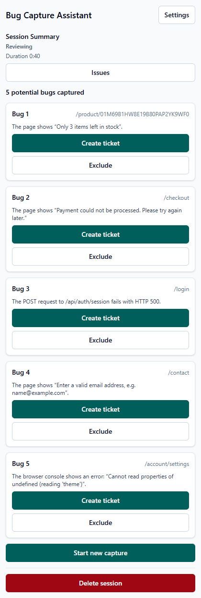
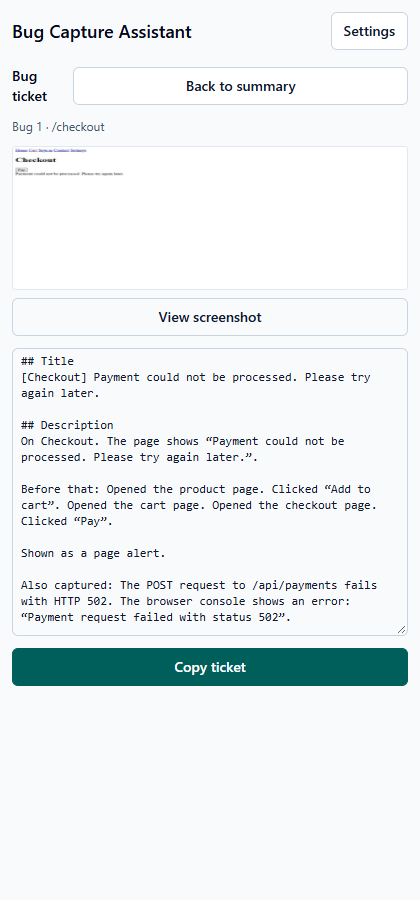

# Bug Capture Assistant

**Bug Capture Assistant** is a local Chrome extension (Manifest V3) for manual and exploratory testing. You still test the page the way you already do, DevTools included. While capture is on, it keeps the steps, page alerts, console errors, failed requests, and a screenshot of that tab, so the ticket comes from what happened instead of from memory.

---

## Why It Exists

When an issue happens during exploratory testing, testers lose time reconstructing what just happened:

- What exact steps led to the error?
- Was there a `console.error` or an unhandled promise rejection?
- Did a `fetch` / `XHR` request fail with `4xx`/`5xx` or a timeout?
- Did a validation alert appear on the page?

Most "AI bug reporters" try to guess root causes from vague prompts and hallucinate details. **Bug Capture Assistant** takes the opposite approach: **evidence-first, deterministic, and 100% local**. It captures real browser signals while you test, groups related events into a single **Potential bug**, attaches a viewport screenshot, and formats a ready-to-paste English bug ticket.

---

## Key Capabilities

- **Automatic Evidence Correlation** — Groups user actions, visible UI alerts, console errors, and failed network requests within a 3-second window on the same page into one **Potential bug** card.
- **Readable Reproduction Steps** — Translates clicks, form submissions, inputs, and page navigations into clean human-readable steps (automatically stripping long query strings and opaque ULID/UUID path segments).
- **Signal Without Noise** — Captures `HTTP 4xx/5xx`, timeouts, and failed requests while filtering out background analytics noise (such as `/g/collect`).
- **One-Click Draft Ticket** — **Create ticket** generates a structured Markdown report (`Title`, `Description`, `Steps to Reproduce`, `Actual Result`, `Expected Result`, `Severity`, `Priority`, `Labels`, `Environment`) with the linked screenshot right above it.
- **Privacy by Default** — Runs entirely on your machine. Sensitive URL parameters (`token`, `password`, `secret`, `session`, etc.) are redacted automatically, and text input values are never stored. No account, no cloud, and no external API keys required.

---

## Quick Install (No Build Required)

1. Download [`releases/bug-capture-assistant-0.1.0-chrome.zip`](./releases/bug-capture-assistant-0.1.0-chrome.zip) (or the same file from [**Releases**](https://github.com/Avngrss/bug-capture-assistant-extension/releases)) and unzip it into a folder on your computer.
2. Open **`chrome://extensions`** in Chrome or Edge (114+).
3. Enable **Developer mode** (top-right toggle).
4. Click **Load unpacked** and select the unzipped folder (the folder containing `manifest.json`).
5. Click the **Bug Capture Assistant** icon in the browser toolbar to open the side panel.

---

## How to Use (60-Second Demo)

1. Open any `http` / `https` web application you want to test (for example, [practicesoftwaretesting.com](https://practicesoftwaretesting.com/)).
2. In the side panel, click **Start capture** and wait for **Capturing this tab**.
3. Interact with the page normally—click buttons, submit forms, navigate between pages.
4. Click **Stop and review**.
5. On any captured bug card, click **Create ticket** → **Copy ticket**, and paste the Markdown into Jira, Linear, GitHub Issues, or your tracker of choice.

### What Triggers a Potential Bug Automatically?

| Category    | What is captured                                                                                                                               |
| ----------- | ---------------------------------------------------------------------------------------------------------------------------------------------- |
| **Console** | `console.error`, uncaught exceptions, and unhandled promise rejections in the monitored tab                                                    |
| **Network** | Failed `fetch` / `XHR` requests (`HTTP 4xx/5xx`, timeouts, aborted or failed transport)                                                        |
| **UI**      | Visible error elements matching CSS rules in **Settings** (defaults: `[role="alert"]`, `[aria-invalid="true"]`, `[data-testid="error-message"]`, `[data-qa="error-message"]`) |

Need to match custom error banners or toasts on your project? Add your CSS selector under **Settings → Advanced UI issue rules**.

---

## Examples

Five bugs from one test pass on a demo shop, and the ticket for the checkout one:

  
  

Full ticket text, exactly as the extension produced it:

- [Product page: stock alert](./examples/product-stock.md)
- [Checkout: payment fails (alert + console + HTTP 502)](./examples/checkout-payment.md)
- [Sign in: API fails silently](./examples/login-api.md)
- [Contact form: validation message](./examples/contact-validation.md)
- [Settings: unhandled promise rejection](./examples/settings-rejection.md)

---

## What's next

Today the extension only collects what happened in the tab and formats a draft you can paste. Later I may add:

- A pass to clean up the wording in the draft on your machine (same steps and signals—you still edit before send).
- Export of a session (screenshot + timeline) for handoff.
- Paste helpers for Jira, Linear, or GitHub Issues.

Open an [**Issue**](https://github.com/Avngrss/bug-capture-assistant-extension/issues) if you want one of these sooner.

---

## Permissions — and Why Each One

Chrome shows these when you load the extension. Each one serves capture on the tab you test, nothing else:

| Permission | Why |
| --- | --- |
| Access to `http` / `https` sites | You choose the site to test, so the extension cannot know it in advance. It collects only on the tab you started capture on, and only while capture runs. |
| `tabs` | Bind capture to one tab, follow its page changes, take a screenshot of what it shows. |
| `scripting` | Start capture on a tab that was already open before the extension loaded. |
| `storage` | Keep your settings and the current session on your computer. |
| `notifications` | Tell you a potential bug was captured while the side panel is closed. |
| `sidePanel` | Show the extension in Chrome's side panel. |

**Nothing leaves your computer.** The extension makes no network requests of its own and has no server, account or analytics: open the extension's service worker in `chrome://extensions` → **Inspect views** → **Network** and see for yourself. Everything it captures stays in this browser.

---

## Feedback & Bug Reports

Testing the demo? Share your thoughts, edge cases, or feature requests in [**Issues**](https://github.com/Avngrss/bug-capture-assistant-extension/issues):

- Which site or scenario you tested
- What worked well vs. what you had to edit in the generated ticket
- Screenshots of the side panel or ticket (if applicable)

---

## License

Copyright (c) 2026 [Avngrss](https://github.com/Avngrss). All rights reserved.  
Provided under a proprietary evaluation license—see [LICENSE](./LICENSE) for details.
